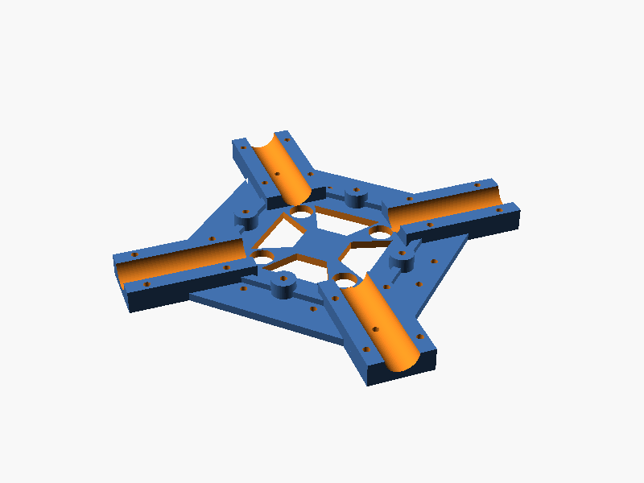
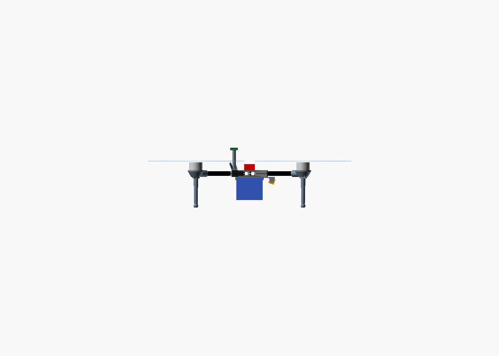
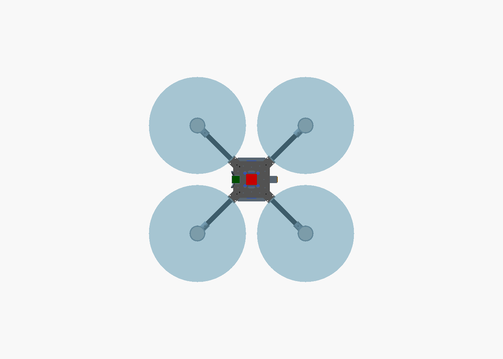

# LongHaul-520: a 3D-printed, 1-hour camera drone (parts from Amazon India)

A slow, steady, GPS-stabilised quadcopter built for **long flight time and a clean HD
video feed**, not speed. You print the frame on a normal 220 × 220 mm FDM printer.
Every electronic part, the remote and the goggles were found on **Amazon.in**.

| | |
|---|---|
| Layout | Quad X, 520 mm motor-to-motor, 13" props |
| Frame | Printed PETG-CF/ASA hub, motor mounts, legs + four 16 mm carbon tubes (from Amazon.in) |
| Motors | Tarot 4108 380KV (6S) |
| Battery | Home-built **6S4P Li-ion** (24 × Molicel P50B 21700), 20 Ah / 432 Wh |
| Take-off weight | ≈ 2.96 kg (≈ 2.5 kg with a 6S3P pack) |
| **Flight time (hover, calm air)** | **≈ 62–76 min, baseline 69 min** (6S3P: ≈ 54–73 min) |
| Thrust-to-weight | ≈ 2.2 : 1, gentle and stable |
| Flight controller | SpeedyBee F405 V4 stack, **ArduPilot** (or INAV) with GPS hold & return-to-home |
| Video | Walksnail Avatar HD 1080p digital, with onboard recording + goggles |
| Remote | RadioMaster Pocket, ExpressLRS 2.4 GHz |

## Why it flies for an hour

1. **Big, slow props + low-KV motors.** A 13" prop on a 380 KV motor makes about twice the
   thrust per watt of a 5" racing quad.
2. **Li-ion instead of LiPo.** 21700 cells store about 2× the energy per gram of LiPo. A
   long-range drone draws little current, so Li-ion's lower power doesn't matter here.
3. **Light structure.** Carbon tubes do the long spans. Printed parts are used only where
   their shape matters.

The numbers are in [`tools/endurance.py`](tools/endurance.py). Change any part weight
and re-run it to see the new flight time.

## What's in this repo

| Path | What |
|------|------|
| [`docs/BOM.md`](docs/BOM.md) | **Full parts list with Amazon.in links**, alternatives and budget (≈ ₹1.3–1.9 lakh) |
| [`docs/BUILD_GUIDE.md`](docs/BUILD_GUIDE.md) | Printing, assembly, battery build, wiring, ArduPilot setup, first flights, Indian drone rules |
| [`cad/longhaul_quad.scad`](cad/longhaul_quad.scad) | Parametric OpenSCAD source (change tube size, wheelbase, camera width, battery size …) |
| [`cad/export_all.sh`](cad/export_all.sh) | Regenerates every STL + preview image |
| [`stl/`](stl) | Ready-to-print parts |
| [`tools/endurance.py`](tools/endurance.py) | Weight & flight-time calculator |
| [`tools/stl_stats.py`](tools/stl_stats.py) | Size and printed-weight of every part |

## Printed parts

| Part | Qty | Size (mm) | ≈ g (PETG-CF) |
|------|-----|-----------|---------------|
| `hub_bottom` | 1 | 164 × 164 × 12 | 98 |
| `hub_top` | 1 | 164 × 164 × 12 | 104 |
| `motor_mount` | 4 | 75 × 54 × 24 | 37 |
| `leg` | 4 | 32 × 16 × 105 | 11 |
| `battery_tray` | 1 | 98 × 150 × 11 | 38 |
| `camera_mount` | 1 | 37 × 24 × 20 | 4 |
| `gps_mast` | 1 | 31 × 60 × 73 | 10 |
| **Total** | | | **≈ 445 g** |

  

 

## Honest limits

* The 69 min figure is a **calm-air hover estimate**. Wind, aggressive flying and cold
  weather all shorten it. Plan on about 55–60 min of real flying with a safe reserve.
  Measure your own numbers during the step-by-step endurance tests in the build guide.
* The motor thrust and efficiency figures come from retailer specs, not from a test bench.
  The motor mount has slotted holes, so other 41xx/35xx motors fit if you change motors.
* Amazon.in listings change. Always confirm the spec line before buying (see the BOM notes).
* Building a Li-ion pack is the one risky step. Follow the safety notes, or have a local
  pack builder assemble your cells.
* At ~3 kg this is a **"small" drone** under India's Drone Rules 2021: it needs DigitalSky
  registration and a Remote Pilot Certificate, and must fly in green zones only.
