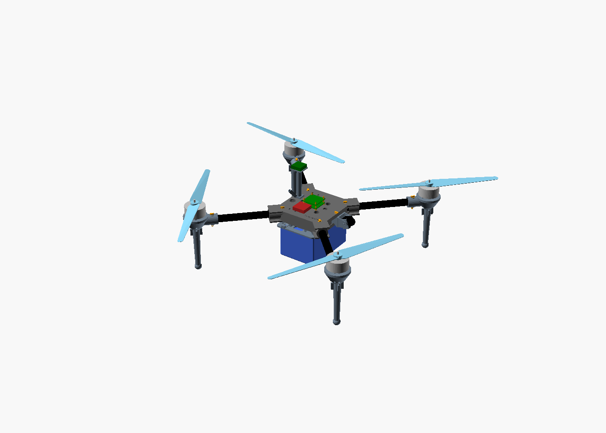
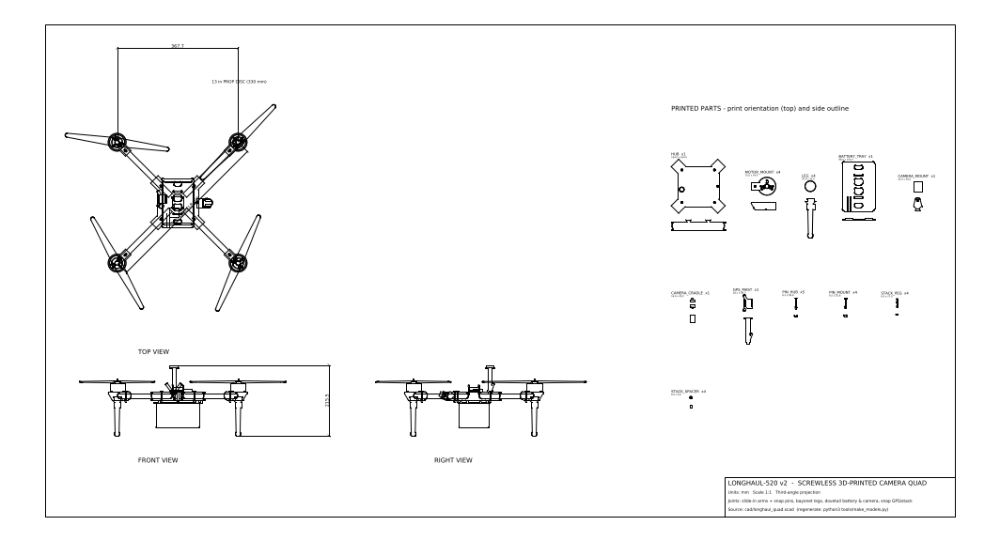
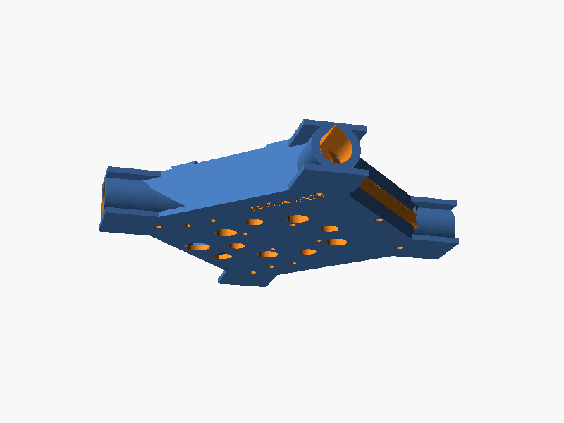
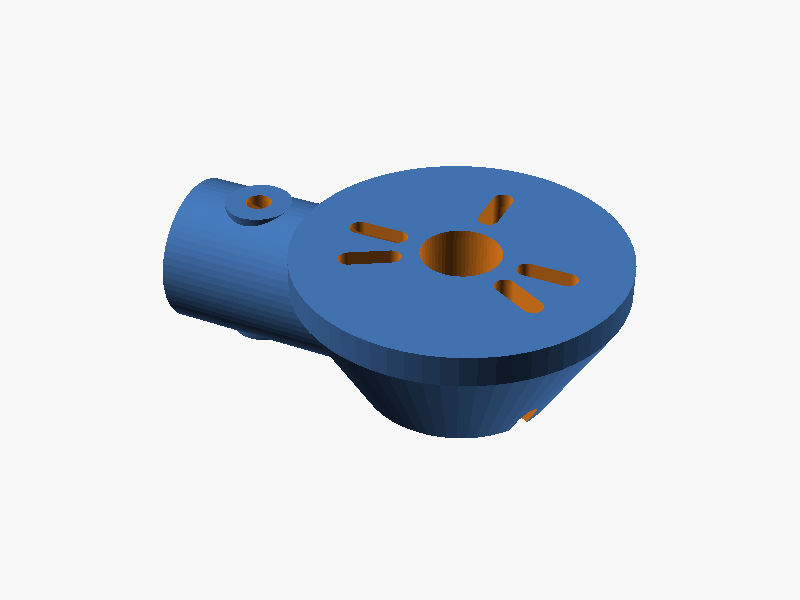
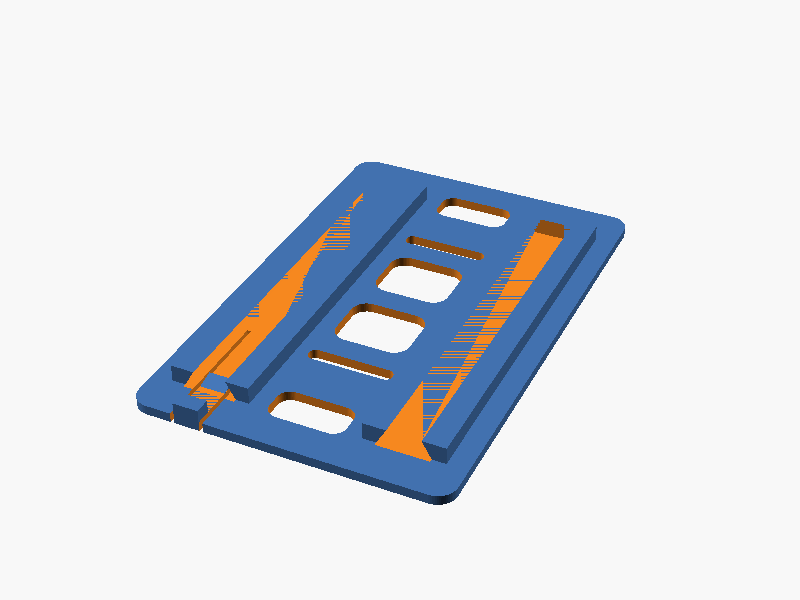
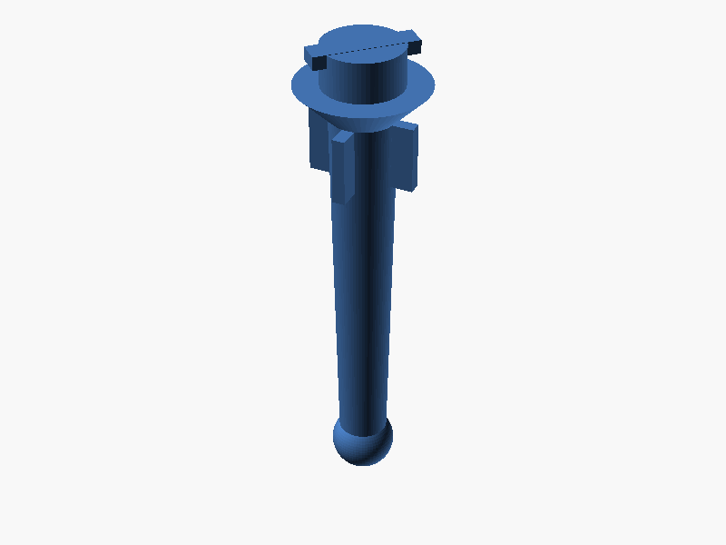
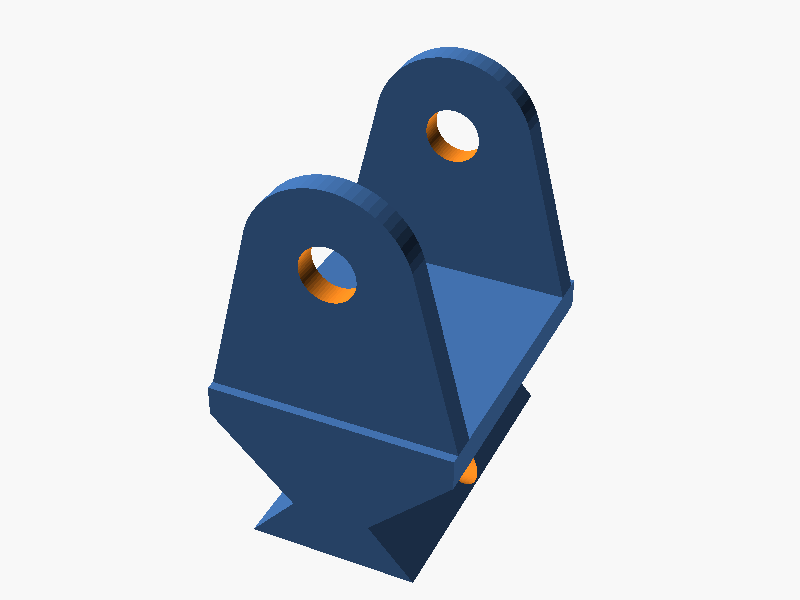
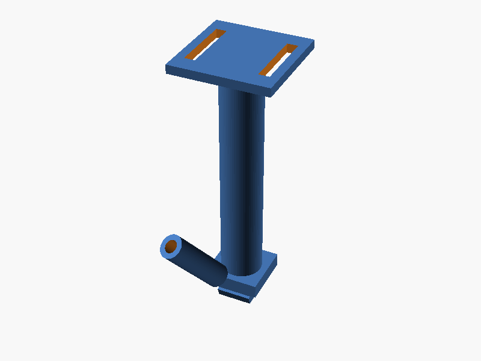
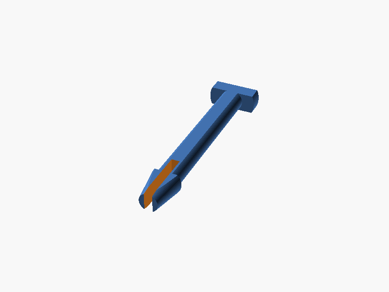

# LongHaul-520: a screwless, 3D-printed, 1-hour camera drone (parts from Amazon India)

A slow, steady, GPS-stabilised quadcopter built for **long flight time and a clean HD
video feed**, not speed. You print the frame on a normal 220 × 220 mm FDM printer.
**v2 has no screws in the frame:** every part slides, twists or snaps together.
Every electronic part, the remote and the goggles were found on **Amazon.in**.

| | |
|---|---|
| Layout | Quad X, 520 mm motor-to-motor, 13" props |
| Frame | One-piece printed hub + four 16 mm carbon tubes, printed motor mounts, legs, tray (PETG-CF/ASA) |
| Joints | Slide-in arms + snap pins · bayonet legs · dovetail battery tray with click latch · dovetail camera mount · snap-fit GPS mast and FC stack |
| Motors | Tarot 4108 380KV (6S), held by the 3 screws that come with each motor (the only screws) |
| Battery | Home-built **6S4P Li-ion** (24 × Molicel P50B 21700), 20 Ah / 432 Wh. Swaps in seconds on the slide-in tray |
| Take-off weight | ≈ 2.98 kg (≈ 2.55 kg with a 6S3P pack) |
| **Flight time (hover, calm air)** | **≈ 61–75 min, baseline 68 min** (6S3P: ≈ 54–72 min) |
| Thrust-to-weight | ≈ 2.2 : 1, gentle and stable |
| Flight controller | SpeedyBee F405 V4 stack, **ArduPilot** (or INAV) with GPS hold & return-to-home |
| Video | Walksnail Avatar HD 1080p digital, with onboard recording + goggles |
| Remote | RadioMaster Pocket, ExpressLRS 2.4 GHz |

## Files you asked for

| File | What it is | Open with |
|------|------------|-----------|
| [`models/longhaul520_assembled.usdz`](models/longhaul520_assembled.usdz) | **Full assembled drone in 3D**, coloured, real size (metres, Y-up, feet on the floor) | iPhone/iPad/Mac Quick Look (tap it to see it in AR), Reality Composer, Blender |
| [`dxf/longhaul520_drawings.dxf`](dxf/longhaul520_drawings.dxf) | **Complete drawing sheet**: front, top and right views of the assembly (one layer per component), every printed part (top + side outline), key dimensions, title block. mm, 1:1 | AutoCAD, LibreCAD (free), DraftSight, Fusion 360, QCAD |
| [`dxf/parts/*.dxf`](dxf/parts) | Flat outline of each printed part, one file each | any CAD / laser cutter software |
| [`stl/*.stl`](stl) | Ready-to-print parts, already in print orientation | any slicer (Cura, PrusaSlicer, Bambu Studio …) |

## How it goes together without screws

| Joint | Mechanism |
|-------|-----------|
| Carbon arm → hub | Tube **slides into a closed socket**, then a printed **snap pin** clicks through hub + tube |
| Carbon arm → motor mount | Mount **slides onto the tube**, then a **snap pin** locks it |
| Leg → motor mount | **Bayonet**: push up, twist 45° |
| Battery tray → hub | **Dovetail rails**. Slide on until it **clicks** (flexure latch). Press the thumb tab to release |
| Camera → hub | Camera **clicks into a cradle**, cradle **trunnions snap** into the mount (tilt by friction), mount **slides into a dovetail** across the hub front and is locked by one snap pin |
| GPS mast → hub | Square **snap-fit tenon** clicks into the hub top |
| FC/ESC stack → hub | Double-ended **snap pegs** + printed spacers |
| Motor → mount | The 3 screws supplied with the motor. A spinning motor must be bolted, so this is the one exception |

  

   

## Why it flies for an hour

1. **Big, slow props + low-KV motors.** A 13" prop on a 380 KV motor makes about twice the
   thrust per watt of a 5" racing quad.
2. **Li-ion instead of LiPo.** 21700 cells store about 2× the energy per gram of LiPo. A
   long-range drone draws little current, so Li-ion's lower power doesn't matter here.
3. **Light structure.** Carbon tubes do the long spans. Printed parts are used only where
   their shape matters.

The numbers are in [`tools/endurance.py`](tools/endurance.py). Change any part weight
and re-run it to see the new flight time.

## What's in this repo

| Path | What |
|------|------|
| [`docs/BOM.md`](docs/BOM.md) | **Full parts list with Amazon.in links**, alternatives and budget (≈ ₹1.3–1.9 lakh) |
| [`docs/BUILD_GUIDE.md`](docs/BUILD_GUIDE.md) | Printing, the joints, assembly, battery build, wiring, ArduPilot setup, first flights, Indian drone rules |
| [`cad/longhaul_quad.scad`](cad/longhaul_quad.scad) | Parametric OpenSCAD source (tube size, wheelbase, camera width, battery size, joint `fit` …) |
| [`cad/export_all.sh`](cad/export_all.sh) | Regenerates every STL + preview image |
| [`tools/make_models.py`](tools/make_models.py) | Regenerates the DXF drawings and the USDZ model |
| [`tools/endurance.py`](tools/endurance.py) | Weight & flight-time calculator |
| [`tools/stl_stats.py`](tools/stl_stats.py) | Size and printed weight of every part |

## Printed parts

| Part | Qty | Size (mm) | ≈ g (PETG-CF) |
|------|-----|-----------|---------------|
| `hub` | 1 | 164 × 164 × 31 | 216 |
| `motor_mount` | 4 | 75 × 54 × 24 | 33 |
| `leg` | 4 | 32 × 32 × 120 | 18 |
| `battery_tray` | 1 | 98 × 150 × 8 | 53 |
| `camera_mount` | 1 | 24 × 30 × 39 | 9 |
| `camera_cradle` | 1 | 16 × 29 × 22 | 2 |
| `gps_mast` | 1 | 28 × 49 × 79 | 9 |
| `pin_hub` / `pin_mount` | 5 / 4 | 35 × 8.5 × 3.4 | < 1 |
| `stack_peg` / `stack_spacer` | 4 / 4 | small | < 1 |
| **Total** | | | **≈ 500 g** |

## Honest limits

* The 68 min figure is a **calm-air hover estimate**. Wind, aggressive flying and cold
  weather all shorten it. Plan on about 55–60 min of real flying with a safe reserve.
  Measure your own numbers during the step-by-step endurance tests in the build guide.
* The motor thrust and efficiency figures come from retailer specs, not from a test bench.
* **Snap joints depend on your printer.** Print the test pieces first and adjust `fit` if
  needed (see the build guide). Check every pin before each flight day and keep spares.
  The tubes need one 4.3 mm hole at each end for the pins.
* Amazon.in listings change. Always confirm the spec line before buying (see the BOM notes).
* Building a Li-ion pack is the one risky step. Follow the safety notes, or have a local
  pack builder assemble your cells.
* At ~3 kg this is a **"small" drone** under India's Drone Rules 2021: it needs DigitalSky
  registration and a Remote Pilot Certificate, and must fly in green zones only.
